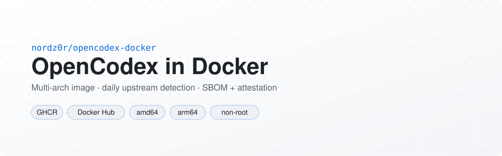

<p align="center">
  <picture>
    <source media="(prefers-color-scheme: dark)" srcset=".github/assets/banner-dark.svg">
    <source media="(prefers-color-scheme: light)" srcset=".github/assets/banner-light.svg">
    
  </picture>
</p>

<p align="right"><a href="README.en.md">English</a> · <b>Русский</b></p>

# OpenCodex в Docker — готовый образ LLM-прокси OpenCodex для Codex CLI и Claude Code

**Запуск [OpenCodex](https://github.com/lidge-jun/opencodex) в Docker одной командой.** Готовый
мультиархитектурный (`linux/amd64`, `linux/arm64`) образ универсального прокси LLM-провайдеров для
OpenAI Codex CLI, Claude Code, Claude Desktop и Grok Build. Образ пересобирается автоматически на
каждый релиз upstream и публикуется в GHCR и Docker Hub.

[](https://hub.docker.com/r/nordz0r/opencodex)
[](https://hub.docker.com/r/nordz0r/opencodex/tags)
[](https://hub.docker.com/r/nordz0r/opencodex)
[](https://github.com/nordz0r/opencodex-docker/releases)
[](https://github.com/nordz0r/opencodex-docker/actions/workflows/build.yml)
[](LICENSE)

В upstream OpenCodex есть Dockerfile для самостоятельной сборки, но **официального готового образа
нет**. Этот репозиторий закрывает пробел: вместо клонирования и сборки достаточно `docker pull`.
Упаковка следует [официальному рецепту Remote Hub](https://opencodex.me/guides/remote-hub/).

- 🐳 **Готовый образ OpenCodex** в `ghcr.io/nordz0r/opencodex` и `docker.io/nordz0r/opencodex`
- 🔁 **Всегда актуален**: новые релизы upstream находятся автоматически, образ собирается из точного
  проверенного git-тега (не форк, код не меняется)
- 🔒 **Защищён**: не root, read-only rootfs, `cap_drop: ALL`, в образе нет секретов
- 🧾 **Проверяем**: SPDX SBOM и GitHub artifact attestation для каждого релиза
- 🧰 **Всё внутри**: встроены CLI `codex`, `claude`, `grok` и `omp`
- 🔌 **[CLI `ocx`](docs/ocx-cli.md)**: одна команда, чтобы подключить к хабу Codex, Claude Code,
  Claude Desktop, Grok Build и Oh My Pi
- 🧭 **[Combo `jev-auto`](docs/jev-combo.md)**: одна модель для клиентов, а цель и effort для
  каждого шага выбирает Jev (TypeSafe System One)

**Содержание:** [Быстрый старт](#быстрый-старт) · [Настройка](#настройка) ·
[Подключение клиентов](#подключение-клиентов) · [CLI ocx](#cli-ocx) · [Обновление](#обновление) ·
[Решение проблем](#решение-проблем) · [Теги образа](#теги-образа) ·
[Гарантии образа](#гарантии-образа) · [Безопасность](#политика-безопасности) · [Лицензия](#лицензия)

## Быстрый старт

Нужен только Docker (для варианта с Compose — плагин Compose). По умолчанию хаб слушает
`127.0.0.1:10100`.

### 1. Создайте ключ доступа

Ключ пускает клиентов к хабу (`/v1/*`). Это **не** ключ провайдера: ключи и OAuth-доступы
провайдеров остаются в томе состояния хаба.

```bash
mkdir -p secrets
openssl rand -hex 32 > secrets/ocx_api_token
chmod 600 secrets/ocx_api_token
```

### 2a. Docker Compose (рекомендуется)

```bash
git clone https://github.com/nordz0r/opencodex-docker.git && cd opencodex-docker
# создайте здесь secrets/ocx_api_token, как в шаге 1
docker compose up -d
curl -fsS http://127.0.0.1:10100/healthz && curl -fsS http://127.0.0.1:10100/readyz
```

В `compose.yaml` стоит плавающий тег `latest`. Для продакшена укажите в `image:` точный тег или
digest, например `ghcr.io/nordz0r/opencodex:2.83.0` или
`ghcr.io/nordz0r/opencodex@sha256:21114343d57ee084f96b303cef9b5887445a5533f3fff6190dbf9a94d18a0d15`
(v2.83.0). Digest каждого релиза есть на [странице релизов](https://github.com/nordz0r/opencodex-docker/releases).

### 2b. docker run

```bash
docker run -d --name opencodex --restart unless-stopped \
  --init --read-only \
  --cap-drop ALL --security-opt no-new-privileges:true \
  --tmpfs /tmp:rw,noexec,nosuid,size=64m,mode=1777 \
  -p 127.0.0.1:10100:10100 \
  -e NODE_ENV=production -e OCX_SERVICE=1 \
  -e OPENCODEX_HOME=/home/bun/.opencodex -e CODEX_HOME=/home/bun/.codex \
  -e OCX_API_TOKEN_FILE=/run/secrets/ocx_api_token \
  -v opencodex_ocx-state:/home/bun/.opencodex \
  -v opencodex_codex-state:/home/bun/.codex \
  -v "$PWD/secrets/ocx_api_token:/run/secrets/ocx_api_token:ro" \
  ghcr.io/nordz0r/opencodex:2.83.0      # или :latest, или @sha256:<digest>

curl -fsS http://127.0.0.1:10100/healthz && curl -fsS http://127.0.0.1:10100/readyz
```

Контейнер работает от UID 1000 (`bun`), поэтому файл ключа должен быть ему доступен на чтение,
см. [Решение проблем](#решение-проблем). Тот же образ есть в Docker Hub: `nordz0r/opencodex:<тег>`.

### 3. Подключите провайдеров

Провайдеры, OAuth-входы и маршрутизация настраиваются через CLI OpenCodex внутри контейнера (он
работает с тем же томом состояния) или через дашборд за вашим HTTPS-фронтендом:

```bash
docker compose exec hub bun run src/cli/index.ts --help
docker compose exec hub bun run src/cli/index.ts status
```

Подробности о провайдерах — в [руководстве Remote Hub](https://opencodex.me/guides/remote-hub/) и
[документации upstream](https://opencodex.me/).

### 4. Проверьте, что клиент проходит

```bash
curl -fsS -H "Authorization: Bearer $(cat secrets/ocx_api_token)" http://127.0.0.1:10100/v1/models
```

`/healthz` лишь показывает, что процесс жив. Для приёмки нужны ещё `/readyz`, авторизованный запрос
к `/v1/catalog` или `/v1/models` и один настоящий ответ модели.

## Настройка

| Параметр | Где | По умолчанию | Назначение |
|---|---|---|---|
| `OPENCODEX_BIND_ADDRESS` | shell / `.env` для Compose | `127.0.0.1` | адрес хоста, на котором публикуется порт (IP в LAN/Tailscale или `0.0.0.0`) |
| `OPENCODEX_PORT` | shell / `.env` для Compose | `10100` | порт на хосте; внутри контейнера всегда `10100` |
| `secrets/ocx_api_token` | файл | — | ключ доступа, монтируется только на чтение в `/run/secrets/ocx_api_token` |
| `OCX_API_TOKEN_FILE` | env контейнера | `/run/secrets/ocx_api_token` | откуда хаб читает ключ |
| `OPENCODEX_HOME` | env контейнера | `/home/bun/.opencodex` | конфиг OpenCodex, доступы провайдеров, статистика (том `ocx-state`) |
| `CODEX_HOME` | env контейнера | `/home/bun/.codex` | состояние Codex и `opencodex-catalog.json` (том `codex-state`) |

Тома в `compose.yaml`: `ocx-state`, `codex-state` и дополнительные `claude-state`
(`/home/bun/.claude`) и `grok-state` (`/home/bun/.grok`) для состояния встроенных CLI. При первом
запуске пустой `ocx-state` получает конфиг хаба из upstream (`runtimeRole=hub`, `hostname=0.0.0.0`).
Существующий `config.json` никогда не перезаписывается.

Чтобы открыть хаб другим машинам, задайте `OPENCODEX_BIND_ADDRESS` и поставьте перед ним
HTTPS- или tailnet-фронтенд с аутентификацией (Caddy, nginx, Tailscale Serve). Иначе клиенты
передают ключ открытым текстом, а `ocx` откажется работать с удалённым HTTP. Порт управления
`10101` никогда не публикуйте.

## Подключение клиентов

| Что | Значение |
|---|---|
| Base URL для OpenAI-совместимых клиентов | `http://127.0.0.1:10100/v1` (или `https://<ваш-хаб>/v1`) |
| Base URL Anthropic (Claude Code) | `http://127.0.0.1:10100` (без `/v1`) |
| Ключ | содержимое `secrets/ocx_api_token` |
| Заголовок | `Authorization: Bearer <ключ>` или `x-opencodex-api-key: <ключ>` |
| Эндпоинты | `POST /v1/responses`, `POST /v1/chat/completions`, `POST /v1/messages`, `GET /v1/models`, `GET /v1/catalog` |
| ID моделей | то, что возвращает `GET /v1/models` для ваших провайдеров |

Быстрее всего через [CLI `ocx`](#cli-ocx): `node bin/ocx.mjs apply --client codex --client claude`.
Ручная настройка:

### Codex CLI

`~/.codex/config.toml` (ровно это пишет `ocx apply --client codex`, только без скачанного каталога
моделей):

```toml
model_provider = "opencodex"

[model_providers.opencodex]
name = "OpenCodex Proxy"
base_url = "http://127.0.0.1:10100/v1"
wire_api = "responses"
requires_openai_auth = true
env_key = "OPENCODEX_API_AUTH_TOKEN"
```

```bash
export OPENCODEX_API_AUTH_TOKEN="$(cat /path/to/secrets/ocx_api_token)"
codex
```

### Claude Code

`~/.claude/settings.json`:

```json
{
  "env": {
    "ANTHROPIC_BASE_URL": "http://127.0.0.1:10100",
    "ANTHROPIC_AUTH_TOKEN": "<ключ>",
    "CLAUDE_CODE_ENABLE_GATEWAY_MODEL_DISCOVERY": "1"
  }
}
```

Или для одного запуска: `ANTHROPIC_BASE_URL=http://127.0.0.1:10100 ANTHROPIC_AUTH_TOKEN=<ключ> claude`.
`ocx apply --client claude` вдобавок раскладывает слоты opus/sonnet/haiku и список `/model` по
назначениям хаба.

### OpenAI-совместимые клиенты (SDK, Open WebUI, Continue, Cursor и др.)

```bash
curl -s http://127.0.0.1:10100/v1/chat/completions \
  -H "Authorization: Bearer $(cat secrets/ocx_api_token)" \
  -H "Content-Type: application/json" \
  -d '{"model":"<id-модели>","messages":[{"role":"user","content":"Привет"}]}'
```

```python
from openai import OpenAI
client = OpenAI(base_url="http://127.0.0.1:10100/v1", api_key=open("secrets/ocx_api_token").read().strip())
print(client.chat.completions.create(model="<id-модели>", messages=[{"role": "user", "content": "Привет"}]).choices[0].message.content)
```

В клиентах с интерфейсом выберите «OpenAI-compatible», укажите base URL и вставьте ключ как API key.

## CLI ocx

[`bin/ocx.mjs`](bin/ocx.mjs) — однофайловый скрипт на Node.js (≥ 18) без зависимостей. Он
настраивает Codex CLI, Claude Code, Claude Desktop, Grok Build и Oh My Pi **на вашей рабочей
машине** на работу через хаб. Каждое изменение записывается в журнал и отменяется командой `restore`.

```bash
curl -fsSLo ocx.mjs https://raw.githubusercontent.com/nordz0r/opencodex-docker/main/bin/ocx.mjs
export OCX_HUB=https://ocx.example.com          # или http://127.0.0.1:10100 на самом хосте хаба
export OCX_API_TOKEN_FILE=~/secrets/ocx_api_token
node ocx.mjs models                              # каталог моделей хаба
node ocx.mjs apply --client codex --client claude
node ocx.mjs restore --client claude             # откатить
node ocx.mjs apply --client omp --omp-judge gpt-6-luna:low   # omp + модель-судья (modelRoles.judge)
```

Для `omp` можно задать роль `judge` — модель, которая отвечает на короткие вопросы-оценки
(автовыбор effort, ранжирование в `find`, `judge()` в eval). Без `--omp-judge` существующая
настройка не меняется; `--omp-judge auto` возвращает цепочку omp по умолчанию. Подробнее:
[docs/ocx-cli.md](docs/ocx-cli.md#модель-судья-omp-judge).

Полное руководство: [docs/ocx-cli.md](docs/ocx-cli.md).

Одна модель `jev-auto`, которая сама выбирает цель и effort для каждого шага через Jev (TypeSafe
System One): [docs/jev-combo.md](docs/jev-combo.md).

## Обновление

```bash
docker compose pull && docker compose up -d     # Compose с :latest
# с закреплённой версией: поменяйте image: на новый тег/digest, затем
docker compose up -d
```

Для `docker run`: `docker pull` нового тега, `docker rm -f opencodex` и та же команда запуска с новым
тегом. Именованные тома сохраняют конфиг, доступы и статистику. Ключ пересоздавать не нужно.

- Точные теги (`2.83.0`) не меняются; `latest`, `2`, `2.83` двигаются с каждым релизом.
- Откат: запустите предыдущий тег или digest на тех же томах.
- `docker compose down` тома сохраняет, а `docker compose down --volumes` **удаляет** конфиг,
  OAuth-доступы, статистику и состояние Codex.
- Что нового: [Releases](https://github.com/nordz0r/opencodex-docker/releases), в каждом релизе
  ссылка на changelog upstream.

## Решение проблем

| Симптом | Что сделать |
|---|---|
| Контейнер перезапускается или хаб пишет, что ключ не найден или не читается | Файл ключа должен читаться UID 1000: `sudo chown 1000:1000 secrets/ocx_api_token && chmod 400 secrets/ocx_api_token` (Compose уже монтирует его с uid 1000 и mode 0440). |
| `/healthz` отвечает 200, а `/readyz` нет | Хаб жив, но не готов: смотрите `docker compose logs hub` и настройку провайдеров. |
| `401` / `403` на `/v1/*` | Неверный или отсутствующий ключ; передавайте `Authorization: Bearer <ключ>` или `x-opencodex-api-key`. |
| `403 origin_rejected` за TLS-прокси при рабочем `/readyz` | Слушатель данных за фронтендом не должен быть привязан к loopback; оставьте умолчание образа (`0.0.0.0` внутри контейнера). См. [Giving the data listener TLS](https://opencodex.me/guides/remote-hub/) в upstream. |
| Не подключиться с другой машины | По умолчанию порт опубликован на `127.0.0.1`. Задайте `OPENCODEX_BIND_ADDRESS`, откройте firewall, добавьте HTTPS. |
| `ocx`: `Use HTTPS for a remote hub` | `ocx` отправляет ключ только по HTTPS или по HTTP на loopback. Нужен HTTPS-фронтенд или SSH-туннель: `ssh -L 10100:127.0.0.1:10100 host`. |
| Codex пишет `catalog_not_found` | Выполните `ocx apply --client codex` (создаёт `opencodex-catalog.json`) или положите каталог в `CODEX_HOME`. |
| Порт занят | `OPENCODEX_PORT=10190 docker compose up -d` |
| Ошибки read-only файловой системы | Так задумано: записывать можно только в `/home/bun/.opencodex`, `/home/bun/.codex`, `/tmp` (и дополнительные тома Compose). |

## Теги образа

| Шаблон тега | Пример | Значение |
|---|---|---|
| `X.Y.Z` / `vX.Y.Z` | `2.83.0`, `v2.83.0` | неизменяемый, совпадает с релизом OpenCodex |
| `X.Y`, `X`, `latest` | `2.83`, `2`, `latest` | плавающие теги для удобства |

Образ есть в обоих реестрах: `ghcr.io/nordz0r/opencodex:<тег>` и `nordz0r/opencodex:<тег>`.
В продакшене закрепляйте полный digest: `ghcr.io/nordz0r/opencodex@sha256:<digest>`.

К каждому релизу прилагаются
[artifact attestation](https://docs.github.com/en/actions/how-tos/secure-your-work/use-artifact-attestations/use-artifact-attestations)
в стиле SLSA и SPDX SBOM. Проверка:

```bash
gh attestation verify oci://ghcr.io/nordz0r/opencodex:2.83.0 -R nordz0r/opencodex-docker
```

## Гарантии образа

- **Не root** (`USER bun`), совместим с read-only rootfs; записывать можно только в
  `/home/bun/.opencodex`, `/home/bun/.codex` (тома состояния) и `/tmp`.
- **Мультиархитектурность**: `linux/amd64` и `linux/arm64` на закреплённой базе
  `oven/bun:1.4.2@sha256:<digest>`.
- **Встроенные CLI**: `codex`, `claude`, `grok`, `omp` (`@oh-my-pi/pi-coding-agent`).
- **Контракт контейнера upstream**: `OCX_SERVICE=1`, отдельный `CODEX_HOME`, проверка версии
  совместимости (`docker/verify-compatibility.ts`), начальный конфиг хаба `docker/config.json`
  (`runtimeRole=hub`, `hostname=0.0.0.0`) копируется, только если в томе нет `config.json`. Ключ
  читается из `OCX_API_TOKEN_FILE=/run/secrets/ocx_api_token` (а не из `service-api-token` в томе,
  как в upstream).
- **Происхождение версии в OCI-метках**: версия upstream, точный коммит, URL исходников, лицензия.
- **Никаких секретов внутри**: нет `auth.json`, токенов и `.env`; ключ доступа читается при запуске
  из `OCX_API_TOKEN_FILE`.
- **Открыт только порт `10100`** (данные). Порт управления `10101` не публикуется; если он нужен,
  привяжите его к loopback внутри своего сетевого namespace.

## Цепочка проверки upstream

`check-upstream.yml` запускается примерно каждые 10 минут (`3,13,23,33,43,53 * * * *`; GitHub может
задерживать):

1. Берёт стабильную версию из npm dist-tag `latest` пакета `@bitkyc08/opencodex` (preview-теги
   игнорируются).
2. Проверяет, что подписанный git-тег upstream `vX.Y.Z` существует и `package.json` в нём объявляет
   ту же версию.
3. Пропускает сборку, если образ с таким тегом уже есть (идемпотентно, без дублей релизов).
4. Иначе запускает `build.yml` с версией и неизменяемым SHA коммита.

Внутри Dockerfile сборка *повторно* проверяет оба факта перед `bun install`, поэтому несовпадение
роняет сборку, а не уходит в релиз.

## Политика безопасности

См. [SECURITY.md](SECURITY.md). Никогда не передавайте токены через build args, env, слои образа или
командную строку. Никогда не монтируйте в контейнер Docker socket, домашний каталог хоста, Codex
home, SSH agent или файлы ключей провайдеров.

## Лицензия

MIT, как и upstream. См. [LICENSE](LICENSE) и [NOTICE](NOTICE).
