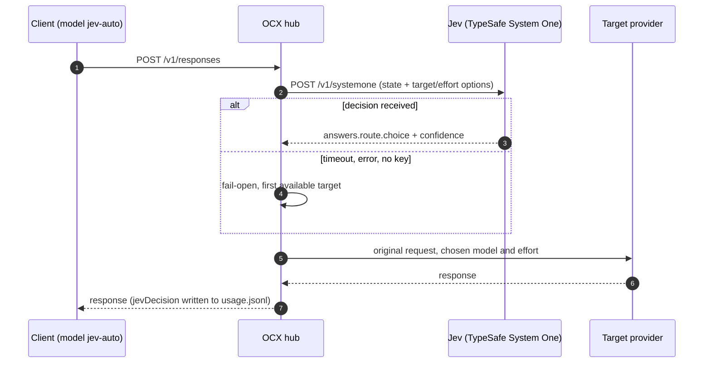

<p align="right"><b>English</b> · <a href="jev-combo.md">Русский</a></p>

# The `jev-auto` combo — smart request routing with Jev (TypeSafe System One)

A combo with the `jev` strategy lets hub clients ask for a single model, `jev-auto`, and hands the
choice of the concrete model and reasoning effort for every step to **Jev** (TypeSafe System
One). This guide shows how such a combo works in the [opencodex-docker](../README.en.md)
container: connecting to TypeSafe, the combo config, rules for `modelProfile`, verification and
common errors.

> Facts were checked against the OpenCodex **v2.83.0** sources. The primary reference is
> [Combos → Decision method](https://opencodex.me/guides/combos/#decision-method) and
> [Configuration → Routing](https://opencodex.me/reference/configuration/routing/) in the
> upstream docs. Every provider, model, address and key below is a **placeholder**.

**Contents:** [What it is](#what-it-is) · [Connecting to TypeSafe](#connecting-to-typesafe) ·
[Combo config](#combo-config) · [Writing modelProfile](#writing-modelprofile) ·
[Tier layout](#example-tier-layout) · [Connecting clients](#connecting-clients) ·
[Verification](#verification) · [Common errors](#common-errors) · [References](#references)

## What it is

- A client (Codex, Claude Code, an SDK, `curl`) sends the hub an ordinary request with
  `model: "jev-auto"`.
- OCX sees that `jev-auto` is a combo with `strategy: "jev"`, builds a **short** description of the
  current step plus the list of allowed "target + effort" pairs, and sends **one** decision request
  to Jev.
- Jev returns a `choice` and a `confidence`. OCX proxies the original request to the chosen target
  with the chosen effort.
- If Jev is unreachable, misses `decisionTimeoutMs`, or answers nonsense, the request **does not
  fail**: OCX uses the first available target (fail-open).

> [!IMPORTANT]
> Jev is **not a client** of the hub and not a model provider. It only decides where the request
> goes; the answer itself comes from the target provider. The `jev` provider row cannot be a combo
> target.



What is and is not sent to Jev:

| Sent (length-bounded) | Never sent |
|---|---|
| up to 500 characters of the current user task | keys, request headers |
| tail of the previous assistant message (240 characters) | image bytes |
| tail of the latest tool output (520 characters) and the tool name | tool arguments |
| `has_image`, `tool_history` flags | full conversation history |
| your `modelProfile` notes (as `operator_notes`) | encrypted reasoning |

A decision is made for **every** model call; there is no per-session pin, so consecutive steps of
one conversation may land on different targets.

## Connecting to TypeSafe

| What | Value |
|---|---|
| Endpoint | `POST https://api.typesafe.ai/v1/systemone` (hard-coded; cannot be changed for the `jev` row) |
| Authorization | `Authorization: Bearer <TYPESAFE_API_KEY>` |
| Model | `jev-latest` (hard-coded) |
| Body format | native System One: `{ "model", "state", "questions" }`. **Not** OpenAI-compatible, not Responses, not Anthropic |
| Limits | request and response up to 64 KiB, up to 64 targets per combo |
| User-Agent | OCX sets `User-Agent: opencodex` itself when none is present |

Where OCX gets the key (in order):

1. `apiKey` of the `jev` provider row in `config.json` (when the row still matches the registry
   transport: `adapter: "jev-decision"`, TypeSafe `baseUrl`);
2. the `TYPESAFE_API_KEY` environment variable;
3. the `JEV_API_KEY` environment variable.

The `jev` provider row is optional: the combo works without it when the hub environment has the key.

### The key in Docker Compose

Our [`compose.yaml`](../compose.yaml) sets container variables under `environment:`, and
[`docker-entrypoint.sh`](../scripts/docker-entrypoint.sh) neither forwards variables nor reads
files — it only seeds the initial `config.json` and starts the hub. OpenCodex has no `*_FILE`
variant for the TypeSafe key, so the key must end up in the process environment. Do not paste it
into `compose.yaml` — use a separate `env_file` under `secrets/` (already in `.gitignore`) and an
override file so the main `compose.yaml` stays untouched:

```bash
umask 077
printf 'TYPESAFE_API_KEY=%s\n' '<typesafe-api-key>' > secrets/typesafe.env
chmod 600 secrets/typesafe.env
```

`compose.override.yaml` next to `compose.yaml` (Compose picks it up automatically):

```yaml
services:
  hub:
    env_file:
      - ./secrets/typesafe.env
```

```bash
docker compose up -d          # recreates the container with the new environment
docker compose exec hub sh -c 'test -n "$TYPESAFE_API_KEY" && echo "TYPESAFE_API_KEY: set"'
```

> [!WARNING]
> An environment variable is visible in `docker inspect` to anyone with Docker access on the host.
> This is a deliberate exception to the [security policy](../SECURITY.md): OpenCodex offers no
> other way to pass the TypeSafe key. The alternative is to store the key on the `jev` provider row
> (dashboard **Providers → TypeSafe JEV** or `ocx provider add jev`); it then lives in the
> `ocx-state` volume.

### Your own System One (self-hosted)

Instead of TypeSafe, the combo can ask a compatible service. That needs a **separate** provider row
with `adapter: "jev-decision"`, and `decisionProvider` set to its id in the combo:

```json
{
  "providers": {
    "my-decider": {
      "adapter": "jev-decision",
      "baseUrl": "https://<self-hosted-systemone>/v1/systemone",
      "apiKey": "${MY_DECIDER_API_KEY}",
      "defaultModel": "<decision-model>",
      "liveModels": false
    }
  },
  "combos": {
    "jev-auto": { "strategy": "jev", "decisionProvider": "my-decider", "targets": [] }
  }
}
```

(`targets` is shortened here — see the full list in [Combo config](#combo-config).)

| Rule | What happens if broken |
|---|---|
| `baseUrl` is the full endpoint URL. HTTPS — any path; plain HTTP — loopback/LAN only and the path must end in `/systemone` | the combo is not saved (`decisionProvider … baseUrl must be …`) |
| A loopback/LAN address needs `allowPrivateNetwork: true` on the row | no request is sent, fail-open |
| The row names its own model: `defaultModel` or the first `models` entry (`jev-latest` is never sent there) | the row is unusable, fail-open with `missing_key` |
| Only **its own** key. Referencing `${TYPESAFE_API_KEY}` / `${JEV_API_KEY}` or another provider's keychain entry is refused | the row is refused, fail-open with `missing_key` |
| Between 2 and 26 "target + effort" options | fewer than 2 — `no_choices`, more than 26 — `invalid`, no request |
| Redirects are not followed | gate `redirect`, fail-open |

Third-party Jev-compatible services behind a CDN/WAF often answer `403` (Cloudflare: code `1010`)
to requests without a `User-Agent`. OCX adds `User-Agent: opencodex` itself, but pass one
explicitly in manual `curl` checks and scripts (`-A 'opencodex'`).

## Combo config

The combo lives in the hub's `config.json` (volume `ocx-state`, path
`/home/bun/.opencodex/config.json`) inside the `combos` object; the object key is the combo id.
An example with five tiers:

```json
{
  "combos": {
    "jev-auto": {
      "alias": "jev-auto",
      "strategy": "jev",
      "decisionTimeoutMs": 6000,
      "reasoningEffortMode": "adaptive",
      "cooldownWaitPolicy": "before-last-resort",
      "defaultEffort": null,
      "targets": [
        {
          "provider": "<fast-provider>",
          "model": "<fast-model>",
          "reasoningEfforts": ["high"],
          "weight": 1,
          "modelProfile": "Step is a chat reply or a non-code tool result; the next step is obvious."
        },
        {
          "provider": "<code-provider>",
          "model": "<code-model>",
          "reasoningEfforts": ["medium", "high"],
          "weight": 1,
          "modelProfile": "Step writes or edits code, or reads a diff, test or compiler output, or terminal output in a coding session."
        },
        {
          "provider": "<general-provider>",
          "model": "<general-model>",
          "reasoningEfforts": ["medium"],
          "weight": 1,
          "modelProfile": "User gives a new multi-step task that needs a plan, or a summary across several sources."
        },
        {
          "provider": "<heavy-provider>",
          "model": "<heavy-model>",
          "reasoningEfforts": ["high", "xhigh"],
          "weight": 1,
          "modelProfile": "Step needs architecture or design decisions, root-cause analysis of a hard failure, or a long plan with trade-offs."
        },
        {
          "provider": "<fallback-provider>",
          "model": "<fallback-model>",
          "reasoningEfforts": ["high"],
          "weight": 1,
          "lastResort": true,
          "modelProfile": "Reserve target, used only when no other target is reachable."
        }
      ]
    }
  }
}
```

**Why `decisionTimeoutMs: 6000`.** The default is 4000 ms. Jev usually answers in a fraction of a
second, but the hub reaches TypeSafe over the public network, and with a 4 s deadline the rare slow
answers turn into fail-open — a silent skew of traffic towards the first target. 6 s leaves room
for those tails while still capping the latency added to one step. Go higher only for a slow
self-hosted service (cold model load).

### Combo fields

| Field | Type / allowed values | Default | Purpose |
|---|---|---|---|
| id (key in `combos`) | letters, digits, `.`, `_`, `-`, up to 64 characters | — | Identifier. Without `alias` clients see the model as `combo/<id>` |
| `alias` | up to 64 characters, at most one `/`, not `combo/…`; bare `gpt-…`, `o3-…` names only with `nativeAlias: true` | none | Public model name: with `alias: "jev-auto"` clients send `model: "jev-auto"` |
| `strategy` | `failover`, `round-robin`, `random`, `least-used`, `reset-window`, `jev` | `failover` | `jev` for Jev |
| `decisionTimeoutMs` | integer 1000–120000 | 4000 | Deadline for Jev's answer; fail-open after it. `jev` only. Out of range: saving via API/CLI is refused; loading `config.json` drops the combo (see [errors](#common-errors)) |
| `decisionProvider` | id of a `jev-decision` row, or `jev` | `jev` (TypeSafe) | Your own System One service. Mutually exclusive with `decisionModel` |
| `decisionModel` | an ordinary OCX route such as `<provider>/<model>` | none | Let an ordinary model decide instead of System One. Mutually exclusive with `decisionProvider` |
| `reasoningEffortMode` | `strict`, `adaptive` | `strict` | How the combo's effort ladder for clients is derived. `adaptive` keeps targets without effort control from emptying it |
| `cooldownWaitPolicy` | `before-last-resort` or unset | unset | Without it `lastResort` does nothing. With it, `lastResort` targets are hidden from Jev while a normal target is available |
| `defaultEffort` | `low` … `ultra` or `null` | `null` | Effort when the client sends none (`defaultEffortMode: "force"` — always). Jev's choice replaces it |
| `stickyLimit` | integer 1–100 | 1 | Used by the `round-robin` strategy only; not needed for `jev` |
| `targets[]` | non-empty array, up to 64 targets | — | The full allowlist: Jev can never pick anything outside it |
| `targets[].provider` / `.model` | non-empty strings, no duplicate pairs | — | OCX provider and model id. The `jev` provider cannot be a target |
| `targets[].reasoningEfforts` | non-empty array of `low`, `medium`, `high`, `xhigh`, `max`, `ultra`, no duplicates | every effort the model advertises | Efforts Jev may pick. Intersected with the model's ladder; an empty intersection drops the target |
| `targets[].weight` | integer 1–10000 | 1 | Weight for `round-robin` and `random`; does not affect Jev |
| `targets[].lastResort` | `true` / `false` | `false` | Reserve target (only together with `cooldownWaitPolicy`) |
| `targets[].modelProfile` | non-empty string up to 512 characters; tab, LF and CR are the only control characters allowed | none | Your "when to pick this target" note, sent to Jev as `state.operator_notes` |

Each target gives Jev one option per allowed effort; the option key is `<provider>/<model>:<effort>`.

### How to apply

There are two routes: the `ocx combo` CLI (simpler, it supplies the token itself) and the
management API (the only way to set `cooldownWaitPolicy` without the dashboard). Combining them
usually works best: build the combo with the CLI and send only `cooldownWaitPolicy` through the API.

**1. The `ocx combo` CLI** inside the container. The CLI finds the running hub and supplies the
admin token itself:

```bash
# jev-auto.targets.json — just the targets array from the example above
docker compose exec -T hub bun run src/cli/index.ts combo set jev-auto \
  --strategy jev --alias jev-auto --reasoning-effort-mode adaptive \
  --decision-timeout 6000 --targets-file - < jev-auto.targets.json

docker compose exec hub bun run src/cli/index.ts combo show jev-auto
docker compose exec hub bun run src/cli/index.ts combo test --combo jev-auto   # one probe decision
```

The CLI has no flag for `cooldownWaitPolicy`. In the dashboard, the **TypeSafe JEV** provider has
a **Create JEV Auto** button that creates the same kind of combo with id and alias `jev-auto`;
`cooldownWaitPolicy` can be set there as well (**Models → Combos**).

**2. Management API.** In our image `/api/*` is served on the same port **`10100`** as the data
plane: there is no separate management port (see the footnote below). Every `/api/*` request
needs the **admin token** in the `X-OpenCodex-API-Key` header (or `Authorization: Bearer`);
without it the hub answers `401 opencodex admin token required`, or
`503 management API unavailable` if the token could not be initialised.

> [!IMPORTANT]
> The admin token is **not** `secrets/ocx_api_token`. `/run/secrets/ocx_api_token`
> (`OCX_API_TOKEN_FILE`) is the client data-plane key (`/v1/*`), and OpenCodex refuses to use it
> as the admin token. The admin token comes from `OPENCODEX_ADMIN_AUTH_TOKEN`; when that is unset,
> the hub creates the file `$OPENCODEX_HOME/admin-api-token` itself
> (`/home/bun/.opencodex/admin-api-token` in the `ocx-state` volume, format `ocx_admin_…`).

To keep the token out of your shell history and host command lines, read it inside the container
(the image ships `curl`; the service in `compose.yaml` is called `hub`):

```bash
# ocx_api <METHOD> <path> [extra curl args]; the token is read inside the container
ocx_api() {
  docker compose exec -T hub sh -c '
    t="${OPENCODEX_ADMIN_AUTH_TOKEN:-$(cat "$OPENCODEX_HOME/admin-api-token")}"
    m="$1"; p="$2"; shift 2
    curl -fsS -X "$m" "http://127.0.0.1:10100$p" -H "X-OpenCodex-API-Key: $t" "$@"
  ' sh "$@"
}
```

Add `cooldownWaitPolicy` to a combo created with the CLI. The `PUT /api/combos` body is
`{ "id": …, "combo": { … } }` and replaces the whole combo, so take the current one and add the
field:

```bash
ocx_api GET /api/combos \
  | jq '{id: "jev-auto",
         combo: ((.combos[] | select(.id == "jev-auto") | del(.id, .model))
                 + {cooldownWaitPolicy: "before-last-resort"})}' > jev-auto.put.json
ocx_api PUT /api/combos -H 'Content-Type: application/json' --data-binary @- < jev-auto.put.json
```

You can also send the whole combo at once: `jev-auto.put.json` =
`{"id":"jev-auto","combo":{…the content of combos.jev-auto from the example above…}}`. Delete with
`ocx_api DELETE '/api/combos?id=jev-auto'`.

> Footnote. A separate management port exists only when `hub.managementIngress` is enabled in the
> hub's `config.json` (`{"enabled": true, "port": <port>}`): GUI and `/api/*` then additionally
> listen on `127.0.0.1:<port>`, for a local HTTPS frontend such as Tailscale Serve. The option is
> off by default and absent from the image's seed `docker/config.json`.

## Writing modelProfile

Each option reaches Jev with OCX's built-in model profile (`instructions.model_profiles`); your
`modelProfile` is sent **in addition**, in `state.operator_notes`, keyed by target. It is evidence
for the decision, not a command: it cannot widen the allowlist or the effort ladder.

Rules:

- **Up to 512 characters** per profile; the whole Jev request must stay under **64 KiB**
  (otherwise gate `invalid` and fail-open).
- Describe **signals of the current step** that call for this target, not the model's merits.
- No "default", "primary", "best", no prices or subscriptions: such words attract the choice.
- Profiles **must not overlap**. If two profiles match the same step, or one is too broad, one
  target pulls in almost all traffic.
- Write them in English: TypeSafe documents English as the language Jev is most accurate in.
- Do not put anything in a profile that must not be disclosed to the decision service.

| ❌ Bad | ✅ Good | Why |
|---|---|---|
| `Default model, use for everything.` | `Step is a chat reply or a non-code tool result; the next step is obvious.` | "default" and "everything" pull in all traffic |
| `Best and smartest model, very cheap on our plan.` | `Step needs architecture or design decisions, or root-cause analysis of a hard failure.` | advertising, prices and plans instead of step signals |
| `Good at code and planning.` (on two targets) | `Step writes or edits code…` / `User gives a new multi-step task that needs a plan…` | the profiles overlap |

Behaviour to keep in mind:

- **Fail-open.** No key, no usable state, timeout, redirect, HTTP error, malformed answer or a
  choice outside the list — OCX takes the **first available** target and picks the effort as
  `resolveEffortAtOrBelow("medium", <that target's efforts>)`:
  `medium` if offered; otherwise the highest effort below `medium` (`low`); if nothing is below,
  the **lowest** available one. For `["high"]` that is `high`, for `["high", "xhigh"]` — `high`,
  for `["low", "high"]` — `low`. A target without effort control gets no effort. Put first a
  target you are happy to get "by default", and remember its effort may end up above `medium`.
- **lastResort.** With `cooldownWaitPolicy: "before-last-resort"`, targets with
  `lastResort: true` are hidden from Jev while any normal target is available, and offered only
  when nothing else remains. Without `cooldownWaitPolicy` the flag does nothing.
- Jev is not asked twice: if the chosen target fails with a retryable error, the ordinary combo
  failover continues in target order.

## Example tier layout

| Tier | Placeholder | `reasoningEfforts` | When (gist of `modelProfile`) |
|---|---|---|---|
| Fast | `<fast-provider>/<fast-model>` | `["high"]` | chat replies, simple tool results, an obvious next step |
| Code | `<code-provider>/<code-model>` | `["medium", "high"]` | writing and editing code, diffs, test, compiler and terminal output |
| General | `<general-provider>/<general-model>` | `["medium"]` | a new multi-step task, a plan, a summary across sources |
| Heavy | `<heavy-provider>/<heavy-model>` | `["high", "xhigh"]` | architecture, hard debugging, a long plan with trade-offs |
| Reserve | `<fallback-provider>/<fallback-model>` | `["high"]` | `lastResort: true`, only when the others are unavailable |

Tips:

- The more "target + effort" options, the harder the choice. 2–3 efforts per target are usually
  enough.
- Every target switch means a cold provider prompt cache. Do not mix models in one combo that you
  are not willing to alternate between mid-session.

## Connecting clients

To a client, `jev-auto` is just another hub model. Clients need neither the TypeSafe key nor any
Jev settings.

| What | Value |
|---|---|
| Model | `jev-auto` (or `combo/<id>` when no `alias` is set) |
| Base URL | `<hub-url>/v1` |
| Key | `<api-key>` — the hub access key (`secrets/ocx_api_token`), **not** the TypeSafe key |

**Codex CLI.** After [`ocx apply --client codex`](ocx-cli.en.md#what-apply-changes) the hub
catalog already contains `jev-auto`:

```bash
OCX_HUB=<hub-url> node ocx.mjs apply --client codex
export OPENCODEX_API_AUTH_TOKEN='<api-key>'
codex -m jev-auto
```

or permanently via `model = "jev-auto"` in `~/.codex/config.toml`.

`node ocx.mjs models` shows `jev-auto` as `routed`, because the `combo` type is detected by the
`combo/` prefix. To see it as a combo: `OCX_COMBO_PREFIXES=combo/,jev- node ocx.mjs models`.

**OpenAI-compatible client:**

```bash
curl -sS <hub-url>/v1/chat/completions \
  -H 'Authorization: Bearer <api-key>' \
  -H 'Content-Type: application/json' \
  -d '{"model":"jev-auto","messages":[{"role":"user","content":"Fix the failing unit test in src/parser.ts"}]}'
```

## Verification

### 1. The TypeSafe key, directly

A request in the same shape OCX builds (`src/combos/jev.ts`): `state` with the task and signals,
one `route` question of type `choice`, options in `criteria` keyed `<provider>/<model>:<effort>`.
Requires a real key.

`jev-probe.json`:

```json
{
  "model": "jev-latest",
  "state": {
    "task": "Fix the failing unit test in src/parser.ts",
    "signals": { "has_image": false, "tool_history": false },
    "step": { "type": "user_turn" }
  },
  "questions": {
    "route": {
      "type": "choice",
      "instructions": {
        "question": "Which target AND reasoning effort together best fit the next model call?",
        "objective": "Select sufficient capability and reasoning for a correct next step while avoiding unnecessary resource use."
      },
      "criteria": {
        "<fast-provider>/<fast-model>:high": {
          "target": "<fast-provider>/<fast-model>",
          "provider": "<fast-provider>",
          "model": "<fast-model>",
          "reasoning_effort": "high"
        },
        "<code-provider>/<code-model>:medium": {
          "target": "<code-provider>/<code-model>",
          "provider": "<code-provider>",
          "model": "<code-model>",
          "reasoning_effort": "medium"
        }
      }
    }
  }
}
```

```bash
curl -sS https://api.typesafe.ai/v1/systemone \
  -H "Authorization: Bearer $TYPESAFE_API_KEY" \
  -H 'Content-Type: application/json' \
  --data-binary @jev-probe.json | jq '.answers.route'
```

Expect HTTP 200 and an object from which OCX reads `choice` (one of the `criteria` keys) and the
optional `confidence` (0–1) and `probabilities` (over all options, summing to ≈ 1):

```json
{ "choice": "<code-provider>/<code-model>:medium", "confidence": 0.9 }
```

Without hand-written JSON — a synthetic probe decision from the hub itself (spends one Jev call):

```bash
docker compose exec hub bun run src/cli/index.ts combo test --combo jev-auto
```

### 2. End to end through the hub

Send a request with `model: "jev-auto"` (see [Connecting clients](#connecting-clients)) and look at
the latest usage records. The log is in the `ocx-state` volume:
`/home/bun/.opencodex/usage.jsonl`.

```bash
docker compose exec hub tail -n 50 /home/bun/.opencodex/usage.jsonl \
  | jq -c 'select(.jevDecision) | .jevDecision'
```

```json
{"version":1,"comboId":"jev-auto","backend":"typesafe","selected":{"provider":"<code-provider>","model":"<code-model>","effort":"medium"},"gate":"apply","latencyMs":420,"confidence":0.9}
```

| `jevDecision` field | Meaning |
|---|---|
| `gate` | `apply` — Jev's decision was applied. Anything else means fail-open (see below) |
| `selected.provider` / `.model` / `.effort` | where the request went and with which effort |
| `latencyMs` | how long the decision took; compare with `decisionTimeoutMs` |
| `confidence`, `chosenProbability` | Jev's confidence (when the service returned it) |
| `backend` | `typesafe`, `systemone` (your own row) or `model` (`decisionModel`) |
| `usage` | tokens spent on the decision (when the service returned them) |

Per-combo summary: `docker compose exec hub bun run src/cli/index.ts combo stats jev-auto --range 7d`
or through the API with [`ocx_api`](#how-to-apply): `ocx_api GET '/api/usage?jev=1&comboId=jev-auto&range=7d' | jq .`.

## Common errors

| Symptom | Cause | What to do |
|---|---|---|
| `jevDecision` has `gate: "missing_key"`, always the first target | No key: `TYPESAFE_API_KEY`/`JEV_API_KEY` missing from the container environment and no key on the `jev` row; for your own row — it is disabled, has no model, or references the TypeSafe key | Check the `env_file` and recreate the container (`docker compose up -d`); run `combo test` |
| `gate: "timeout"`, always the first target | Jev misses `decisionTimeoutMs` | Compare `latencyMs` with `decisionTimeoutMs`; raise it to 6000 or more, check the network path to `api.typesafe.ai` |
| `gate: "network"`, always the first target | Network failure of the decision request (DNS, connection, TLS), not a timeout | Check that the container reaches `api.typesafe.ai:443` (`docker compose exec hub curl -sSI https://api.typesafe.ai`), proxies and `NO_PROXY` |
| `gate: "no_state"` | The request carries no task text, tool output or image | Normal for housekeeping calls; if every request shows it, the client sends an empty `input` |
| `gate: "invalid"` | The Jev request exceeds 64 KiB, more than 64 targets, an over-long field, or the hub API key's scope denies the decision destination | Trim `targets` and `modelProfile`, check the key scope |
| `gate: "http"` / `"redirect"` / `"malformed"` | HTTP error, redirect or unparseable answer from the decision service | Check the key and URL; for your own row — the exact final URL |
| One target pulls in almost all traffic | A "magnetic" profile (default, best, prices) or overlapping profiles | Rewrite the profiles per the [rules](#writing-modelprofile); watch `combo stats` |
| The reserve target is picked while normal ones are up | `cooldownWaitPolicy: "before-last-resort"` is missing | Add it via the API or the dashboard |
| Your `jev-decision` row is not saved or is ignored | `apiKey` references `$TYPESAFE_API_KEY`/`$JEV_API_KEY`; an HTTP URL not on loopback/LAN or not ending in `/systemone`; no `defaultModel` | Give the row its own key and model, an HTTPS URL or a local `…/systemone` with `allowPrivateNetwork: true` |
| A manual `curl` to a third-party System One returns `403` / `error code: 1010` | A WAF/CDN rejects requests without `User-Agent` | Add `-A 'opencodex'`; OCX itself sets the header automatically |
| The combo is rejected: `targets[i].modelProfile must be … at most 512 characters` | Profile longer than 512 characters or containing control characters other than tab, LF and CR | Shorten the profile |
| API/CLI answers `decisionTimeoutMs must be an integer from 1000 to 120000` | Out-of-range value on save — the combo is not saved | Use an integer between 1000 and 120000 |
| The `jev-auto` combo is gone after a manual `config.json` edit; the hub log warns about a dropped `combos` entry | On file load an invalid combo (for example `decisionTimeoutMs` outside 1000–120000) is dropped whole; the rest of the config survives | Fix the value and restart the hub; 4000 is only a runtime fallback for a value that bypassed validation |
| `401 opencodex admin token required` / `503 management API unavailable` on `/api/*` | Missing or wrong admin token; `ocx_api_token` sent instead of the admin token | Use [`ocx_api`](#how-to-apply) or the `ocx combo` CLI |

## References

- Upstream docs: [Combos → Decision method](https://opencodex.me/guides/combos/#decision-method),
  [Configuration → Routing](https://opencodex.me/reference/configuration/routing/),
  [Management API](https://opencodex.me/reference/management-api/).
- Upstream sources (v2.83.0):
  [`src/combos/jev.ts`](https://github.com/lidge-jun/opencodex/blob/v2.83.0/src/combos/jev.ts),
  [`jev-service-exchange.ts`](https://github.com/lidge-jun/opencodex/blob/v2.83.0/src/combos/jev-service-exchange.ts),
  [`jev-decision-contract.ts`](https://github.com/lidge-jun/opencodex/blob/v2.83.0/src/combos/jev-decision-contract.ts),
  [`src/combos/types.ts`](https://github.com/lidge-jun/opencodex/blob/v2.83.0/src/combos/types.ts),
  [`src/cli/combo.ts`](https://github.com/lidge-jun/opencodex/blob/v2.83.0/src/cli/combo.ts),
  [`src/server/management/combo-routes.ts`](https://github.com/lidge-jun/opencodex/blob/v2.83.0/src/server/management/combo-routes.ts),
  [`src/usage/jev-stats.ts`](https://github.com/lidge-jun/opencodex/blob/v2.83.0/src/usage/jev-stats.ts).
- TypeSafe: [docs.typesafe.ai](https://docs.typesafe.ai/).
- In this repository: [README](../README.en.md), [ocx CLI](ocx-cli.en.md), [SECURITY.md](../SECURITY.md).
