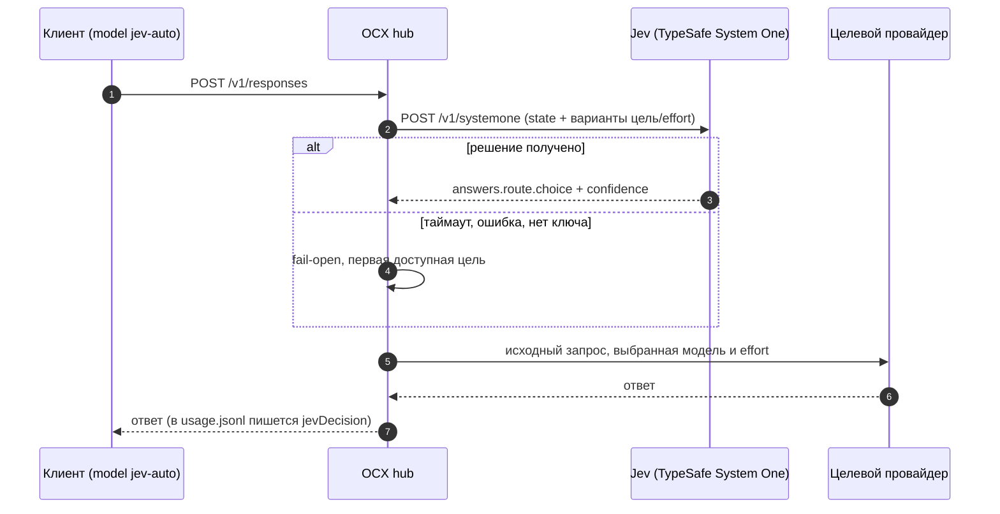

<p align="right"><a href="jev-combo.en.md">English</a> · <b>Русский</b></p>

# Combo `jev-auto` — умная маршрутизация запросов через Jev (TypeSafe System One)

Combo со стратегией `jev` позволяет клиентам хаба указывать одну модель, `jev-auto`, а выбор
конкретной модели и уровня reasoning effort для каждого шага поручить сервису **Jev** (TypeSafe
System One). Здесь описано, как такой combo устроен в контейнере [opencodex-docker](../README.md):
подключение к TypeSafe, конфиг combo, правила для `modelProfile`, проверка и типичные ошибки.

> Факты сверены с исходниками OpenCodex **v2.83.0**. Первоисточник —
> [Combos → Decision method](https://opencodex.me/guides/combos/#decision-method) и
> [Configuration → Routing](https://opencodex.me/reference/configuration/routing/) в документации
> upstream. Все имена провайдеров, моделей, адреса и ключи ниже — **плейсхолдеры**.

**Содержание:** [Что это](#что-это) · [Подключение к TypeSafe](#подключение-к-typesafe) ·
[Конфиг combo](#конфиг-combo) · [Как писать modelProfile](#как-писать-modelprofile) ·
[Раскладка по уровням](#пример-раскладки-по-уровням) ·
[Подключение клиентов](#подключение-клиентов) · [Проверка](#проверка) ·
[Типичные ошибки](#типичные-ошибки) · [Ссылки](#ссылки)

## Что это

- Клиент (Codex, Claude Code, SDK, `curl`) отправляет в хаб обычный запрос с `model: "jev-auto"`.
- OCX видит, что `jev-auto` — combo со `strategy: "jev"`, собирает **короткое** описание текущего
  шага и список допустимых пар «цель + effort» и отправляет **один** запрос решения в Jev.
- Jev возвращает выбор (`choice`) и `confidence`. OCX проксирует исходный запрос выбранной цели с
  выбранным effort.
- Если Jev недоступен, не уложился в `decisionTimeoutMs` или ответил ерундой, запрос **не падает**:
  OCX берёт первую доступную цель (fail-open).

> [!IMPORTANT]
> Jev — **не клиент** хаба и не провайдер модели. Он только выбирает, куда отправить запрос; сам
> ответ генерирует целевой провайдер. Строка провайдера `jev` не может быть целью combo.



Что уходит в Jev, а что нет:

| Отправляется (с ограничениями по длине) | Не отправляется |
|---|---|
| до 500 символов текущей задачи пользователя | ключи, заголовки запроса |
| хвост предыдущего ответа ассистента (240 символов) | байты изображений |
| хвост последнего вывода инструмента (520 символов) и имя инструмента | аргументы инструментов |
| флаги `has_image`, `tool_history` | полная история диалога |
| ваши `modelProfile` (как `operator_notes`) | зашифрованный reasoning |

Решение принимается для **каждого** вызова модели, привязки к сессии нет: соседние шаги одного
диалога могут уйти на разные цели.

## Подключение к TypeSafe

| Что | Значение |
|---|---|
| Эндпоинт | `POST https://api.typesafe.ai/v1/systemone` (зашит в код, для строки `jev` не меняется) |
| Авторизация | `Authorization: Bearer <TYPESAFE_API_KEY>` |
| Модель | `jev-latest` (зашита в код) |
| Формат тела | нативный System One: `{ "model", "state", "questions" }`. **Не** OpenAI-compatible, не Responses и не Anthropic |
| Лимиты | запрос и ответ до 64 KiB, до 64 целей в combo |
| User-Agent | OCX сам ставит `User-Agent: opencodex`, если его нет |

Откуда OCX берёт ключ (по порядку):

1. `apiKey` строки провайдера `jev` в `config.json` (если строка совпадает с транспортом из
   реестра: `adapter: "jev-decision"`, `baseUrl` TypeSafe);
2. переменная окружения `TYPESAFE_API_KEY`;
3. переменная окружения `JEV_API_KEY`.

Строка провайдера `jev` не обязательна: без неё combo работает, если в окружении хаба есть ключ.

### Ключ в Docker Compose

В нашем [`compose.yaml`](../compose.yaml) переменные контейнера заданы в `environment:`, а
[`docker-entrypoint.sh`](../scripts/docker-entrypoint.sh) ничего не пробрасывает и не читает из
файлов — он только кладёт стартовый `config.json` и запускает хаб. Варианта `*_FILE` для ключа
TypeSafe в OpenCodex нет, поэтому ключ должен оказаться в окружении процесса. Не вписывайте его
прямо в `compose.yaml` — используйте отдельный `env_file` в каталоге `secrets/` (он уже в
`.gitignore`) и файл переопределения, чтобы не трогать основной `compose.yaml`:

```bash
umask 077
printf 'TYPESAFE_API_KEY=%s\n' '<typesafe-api-key>' > secrets/typesafe.env
chmod 600 secrets/typesafe.env
```

`compose.override.yaml` рядом с `compose.yaml` (Compose подхватывает его автоматически):

```yaml
services:
  hub:
    env_file:
      - ./secrets/typesafe.env
```

```bash
docker compose up -d          # пересоздаст контейнер с новым окружением
docker compose exec hub sh -c 'test -n "$TYPESAFE_API_KEY" && echo "TYPESAFE_API_KEY: set"'
```

> [!WARNING]
> Переменная окружения видна в `docker inspect` тем, у кого есть доступ к Docker на хосте. Это
> осознанное исключение из [политики безопасности](../SECURITY.md): другого способа передать ключ
> TypeSafe у OpenCodex нет. Альтернатива — сохранить ключ в строке провайдера `jev` (дашборд
> **Providers → TypeSafe JEV** или `ocx provider add jev`); тогда он лежит в томе `ocx-state`.

### Свой System One (self-hosted)

Вместо TypeSafe combo может спрашивать совместимый сервис. Для этого нужна **отдельная** строка
провайдера с `adapter: "jev-decision"`, а в combo — `decisionProvider` с её id:

```json
{
  "providers": {
    "my-decider": {
      "adapter": "jev-decision",
      "baseUrl": "https://<self-hosted-systemone>/v1/systemone",
      "apiKey": "${MY_DECIDER_API_KEY}",
      "defaultModel": "<decision-model>",
      "liveModels": false
    }
  },
  "combos": {
    "jev-auto": { "strategy": "jev", "decisionProvider": "my-decider", "targets": [] }
  }
}
```

(`targets` здесь сокращён — полный список см. в [конфиге combo](#конфиг-combo).)

| Правило | Что будет, если нарушить |
|---|---|
| `baseUrl` — полный URL эндпоинта. HTTPS — любой путь; обычный HTTP — только на loopback/LAN и путь, оканчивающийся на `/systemone` | combo не сохранится (`decisionProvider … baseUrl must be …`) |
| Для loopback/LAN-адреса на строке нужен `allowPrivateNetwork: true` | запрос не уйдёт, сработает fail-open |
| У строки своя модель: `defaultModel` или первый элемент `models` (`jev-latest` туда не отправляется) | строка считается непригодной, fail-open с `missing_key` |
| Только **свой** ключ. Ссылка на `${TYPESAFE_API_KEY}` / `${JEV_API_KEY}` или чужой keychain запрещена | строка отклоняется, fail-open с `missing_key` |
| Вариантов «цель + effort» от 2 до 26 | меньше 2 — `no_choices`, больше 26 — `invalid`, без запроса |
| Редиректы не поддерживаются | gate `redirect`, fail-open |

Сторонние Jev-совместимые сервисы за CDN/WAF часто отвечают `403` (у Cloudflare — код `1010`)
на запросы без `User-Agent`. OCX подставляет `User-Agent: opencodex` сам, но в ручных проверках
через `curl` и скриптах передавайте его явно (`-A 'opencodex'`).

## Конфиг combo

Combo хранится в `config.json` хаба (том `ocx-state`, путь `/home/bun/.opencodex/config.json`)
в объекте `combos`, ключ объекта — id combo. Пример с пятью уровнями:

```json
{
  "combos": {
    "jev-auto": {
      "alias": "jev-auto",
      "strategy": "jev",
      "decisionTimeoutMs": 6000,
      "reasoningEffortMode": "adaptive",
      "cooldownWaitPolicy": "before-last-resort",
      "defaultEffort": null,
      "targets": [
        {
          "provider": "<fast-provider>",
          "model": "<fast-model>",
          "reasoningEfforts": ["high"],
          "weight": 1,
          "modelProfile": "Step is a chat reply or a non-code tool result; the next step is obvious."
        },
        {
          "provider": "<code-provider>",
          "model": "<code-model>",
          "reasoningEfforts": ["medium", "high"],
          "weight": 1,
          "modelProfile": "Step writes or edits code, or reads a diff, test or compiler output, or terminal output in a coding session."
        },
        {
          "provider": "<general-provider>",
          "model": "<general-model>",
          "reasoningEfforts": ["medium"],
          "weight": 1,
          "modelProfile": "User gives a new multi-step task that needs a plan, or a summary across several sources."
        },
        {
          "provider": "<heavy-provider>",
          "model": "<heavy-model>",
          "reasoningEfforts": ["high", "xhigh"],
          "weight": 1,
          "modelProfile": "Step needs architecture or design decisions, root-cause analysis of a hard failure, or a long plan with trade-offs."
        },
        {
          "provider": "<fallback-provider>",
          "model": "<fallback-model>",
          "reasoningEfforts": ["high"],
          "weight": 1,
          "lastResort": true,
          "modelProfile": "Reserve target, used only when no other target is reachable."
        }
      ]
    }
  }
}
```

**Почему `decisionTimeoutMs: 6000`.** По умолчанию 4000 мс. Обычно Jev отвечает за доли секунды,
но хаб ходит в TypeSafe по внешней сети, и редкие медленные ответы при 4 с превращаются в
fail-open, то есть в тихий перекос трафика на первую цель. 6 с дают запас на такие хвосты и всё
ещё ограничивают добавку к задержке одного шага. Значение выше имеет смысл только для медленного
self-hosted сервиса (холодная загрузка модели).

### Поля combo

| Поле | Тип / допустимые значения | По умолчанию | Назначение |
|---|---|---|---|
| id (ключ в `combos`) | буквы, цифры, `.`, `_`, `-`, до 64 символов | — | Идентификатор. Без `alias` модель видна клиентам как `combo/<id>` |
| `alias` | до 64 символов, не более одного `/`, не `combo/…`; голые имена вида `gpt-…`, `o3-…` только с `nativeAlias: true` | нет | Публичное имя модели: с `alias: "jev-auto"` клиенты пишут `model: "jev-auto"` |
| `strategy` | `failover`, `round-robin`, `random`, `least-used`, `reset-window`, `jev` | `failover` | Для Jev — `jev` |
| `decisionTimeoutMs` | целое 1000–120000 | 4000 | Срок ответа Jev; по истечении — fail-open. Только для `jev`. Значение вне диапазона: при сохранении через API/CLI — отказ, при загрузке `config.json` — combo отбрасывается (см. [ошибки](#типичные-ошибки)) |
| `decisionProvider` | id строки `jev-decision` или `jev` | `jev` (TypeSafe) | Свой System One-сервис. Несовместим с `decisionModel` |
| `decisionModel` | обычный маршрут OCX, например `<provider>/<model>` | нет | Принимать решение обычной моделью вместо System One. Несовместим с `decisionProvider` |
| `reasoningEffortMode` | `strict`, `adaptive` | `strict` | Как вычисляется лестница effort combo для клиента. `adaptive` не даёт целям без effort «обнулить» её |
| `cooldownWaitPolicy` | `before-last-resort` или не задано | не задано | Без этого поля `lastResort` ни на что не влияет. С ним цели `lastResort` не показываются Jev, пока есть обычная цель |
| `defaultEffort` | `low` … `ultra` или `null` | `null` | Effort, если клиент его не передал (`defaultEffortMode: "force"` — всегда). Выбор Jev его заменяет |
| `stickyLimit` | целое 1–100 | 1 | Используется только стратегией `round-robin`; для `jev` не нужен |
| `targets[]` | непустой массив, до 64 целей | — | Полный allowlist: Jev не может выбрать ничего вне списка |
| `targets[].provider` / `.model` | непустые строки, пара не повторяется | — | Провайдер и id модели в OCX. Провайдер `jev` целью быть не может |
| `targets[].reasoningEfforts` | непустой массив из `low`, `medium`, `high`, `xhigh`, `max`, `ultra` без повторов | все effort, которые объявляет модель | Какие effort Jev может выбрать. Пересекается с лестницей модели; если пересечение пустое, цель исключается |
| `targets[].weight` | целое 1–10000 | 1 | Вес для `round-robin` и `random`; на выбор Jev не влияет |
| `targets[].lastResort` | `true` / `false` | `false` | Резервная цель (работает только вместе с `cooldownWaitPolicy`) |
| `targets[].modelProfile` | непустая строка до 512 символов; из управляющих символов допустимы только таб, LF и CR | нет | Ваше описание «когда брать эту цель», уходит в Jev как `state.operator_notes` |

Каждая цель даёт Jev по одному варианту на каждый допустимый effort, ключ варианта —
`<provider>/<model>:<effort>`.

### Как применить

Есть два пути: CLI `ocx combo` (проще, токен подставляется сам) и management API (через него — или
правкой `config.json` — задаётся `cooldownWaitPolicy`; в CLI и дашборде этого поля нет). Обычно удобно их совместить: собрать combo
через CLI, а через API дослать только `cooldownWaitPolicy`.

**1. CLI `ocx combo`** внутри контейнера. CLI сам находит работающий хаб и сам подставляет
admin-токен:

```bash
# jev-auto.targets.json — только массив targets из примера выше
docker compose exec -T hub bun run src/cli/index.ts combo set jev-auto \
  --strategy jev --alias jev-auto --reasoning-effort-mode adaptive \
  --decision-timeout 6000 --targets-file - < jev-auto.targets.json

docker compose exec hub bun run src/cli/index.ts combo show jev-auto
docker compose exec hub bun run src/cli/index.ts combo test --combo jev-auto   # один пробный запрос решения
```

У CLI нет флага для `cooldownWaitPolicy`, в дашборде этого поля тоже нет. В дашборде есть кнопка
**Create JEV Auto** (в обзоре провайдера **TypeSafe JEV** и в **Models → Combos**), которая
создаёт такой же combo с id и alias `jev-auto`. Сохранение combo из дашборда или CLI без
`cooldownWaitPolicy` уже заданное значение не сбрасывает.

**2. Management API.** В нашем образе `/api/*` обслуживается тем же портом **`10100`**, что и
данные: отдельного порта управления нет (см. сноску ниже). Каждый запрос к `/api/*` требует
**admin-токен** в заголовке `X-OpenCodex-API-Key` (или `Authorization: Bearer`); без него хаб
отвечает `401 opencodex admin token required`, а если токен не инициализирован —
`503 management API unavailable`.

> [!IMPORTANT]
> Admin-токен — это **не** `secrets/ocx_api_token`. Файл `/run/secrets/ocx_api_token`
> (`OCX_API_TOKEN_FILE`) — ключ доступа клиентов к данным (`/v1/*`), и OpenCodex запрещает
> использовать его как admin-токен. Admin-токен берётся из `OPENCODEX_ADMIN_AUTH_TOKEN`, а если
> переменная не задана, хаб сам создаёт файл `$OPENCODEX_HOME/admin-api-token`
> (`/home/bun/.opencodex/admin-api-token` в томе `ocx-state`, формат `ocx_admin_…`).

Чтобы токен не попадал в историю shell и в аргументы команд на хосте, читайте его внутри
контейнера (в образе есть `curl`, сервис в `compose.yaml` называется `hub`):

```bash
# ocx_api <METHOD> <path> [доп. аргументы curl]; токен читается внутри контейнера
ocx_api() {
  docker compose exec -T hub sh -c '
    t="${OPENCODEX_ADMIN_AUTH_TOKEN:-$(cat "$OPENCODEX_HOME/admin-api-token")}"
    m="$1"; p="$2"; shift 2
    curl -fsS -X "$m" "http://127.0.0.1:10100$p" -H "X-OpenCodex-API-Key: $t" "$@"
  ' sh "$@"
}
```

Дослать `cooldownWaitPolicy` в combo, созданный через CLI. Тело `PUT /api/combos` —
`{ "id": …, "combo": { … } }`, combo передаётся целиком, поэтому берём текущий и добавляем поле.
`GET /api/combos` отдаёт незаданные поля как `null` (например, `displayName: null`), а `PUT` такие
значения не принимает (`400 displayName must be a string`), поэтому `null` убираются:

```bash
ocx_api GET /api/combos \
  | jq '{id: "jev-auto",
         combo: ((.combos[] | select(.id == "jev-auto")
                  | del(.id, .model) | with_entries(select(.value != null)))
                 + {cooldownWaitPolicy: "before-last-resort"})}' > jev-auto.put.json
ocx_api PUT /api/combos -H 'Content-Type: application/json' --data-binary @- < jev-auto.put.json
```

Так же можно сразу отправить весь combo: `jev-auto.put.json` =
`{"id":"jev-auto","combo":{…содержимое combos.jev-auto из примера выше…}}`. Удаление —
`ocx_api DELETE '/api/combos?id=jev-auto'`.

> Сноска. Отдельный порт управления появляется, только если в `config.json` хаба включить
> `hub.managementIngress` (`{"enabled": true, "port": <порт>}`): тогда GUI и `/api/*`
> дополнительно слушают `127.0.0.1:<порт>` — для локального HTTPS-фронтенда вроде Tailscale Serve.
> По умолчанию опция выключена, и в стартовом `docker/config.json` образа её нет.

## Как писать modelProfile

Каждый вариант Jev получает встроенный профиль модели из OCX (`instructions.model_profiles`), а
ваш `modelProfile` идёт **дополнительно** в `state.operator_notes` с ключом цели. Это доказательство
для решения, а не команда: расширить allowlist или лестницу effort он не может.

Правила:

- **До 512 символов** на профиль; весь запрос к Jev — до **64 KiB** (иначе gate `invalid` и
  fail-open).
- Описывайте **признаки текущего шага**, при которых нужна эта цель, а не достоинства модели.
- Без слов «default», «основная», «лучшая», без цен и подписок: такие слова притягивают выбор.
- Профили **не должны пересекаться**. Если два профиля подходят к одному шагу или один из них
  слишком общий, одна цель забирает почти весь трафик.
- Пишите по-английски: по документации TypeSafe Jev точнее всего работает на английском.
- Не кладите в профиль ничего, что нельзя раскрывать сервису решений.

| ❌ Плохо | ✅ Хорошо | Почему |
|---|---|---|
| `Default model, use for everything.` | `Step is a chat reply or a non-code tool result; the next step is obvious.` | «default» и «everything» стягивают весь трафик |
| `Best and smartest model, very cheap on our plan.` | `Step needs architecture or design decisions, or root-cause analysis of a hard failure.` | реклама, цены и подписки вместо признаков шага |
| `Good at code and planning.` (у двух целей) | `Step writes or edits code…` / `User gives a new multi-step task that needs a plan…` | профили пересекаются |

Поведение, о котором стоит помнить:

- **Fail-open.** Нет ключа, нет пригодного состояния, таймаут, редирект, HTTP-ошибка, битый
  ответ или выбор вне списка — OCX берёт **первую доступную** цель, а effort выбирает как
  `resolveEffortAtOrBelow("medium", <effort этой цели>)`:
  `medium`, если он есть; иначе самый высокий из effort ниже `medium` (`low`); если ниже нет
  ничего — самый **низкий** из доступных. Для `["high"]` это `high`, для `["high", "xhigh"]` —
  `high`, для `["low", "high"]` — `low`. Если у цели нет управления effort — без effort. Ставьте
  первой цель, которую не жалко получить «по умолчанию», и помните, что effort у неё может
  оказаться выше `medium`.
- **lastResort.** При `cooldownWaitPolicy: "before-last-resort"` цели с `lastResort: true`
  не показываются Jev, пока доступна хоть одна обычная цель, и предлагаются, только когда
  ничего другого не осталось. Без `cooldownWaitPolicy` флаг ничего не делает.
- Jev не спрашивают повторно: если выбранная цель упала с повторяемой ошибкой, дальше работает
  обычный failover combo по порядку целей.

## Пример раскладки по уровням

| Уровень | Плейсхолдер | `reasoningEfforts` | Когда (суть `modelProfile`) |
|---|---|---|---|
| Быстрый | `<fast-provider>/<fast-model>` | `["high"]` | ответ в чате, простой результат инструмента, очевидный следующий шаг |
| Код | `<code-provider>/<code-model>` | `["medium", "high"]` | написание и правка кода, diff, вывод тестов, компилятора, терминала |
| Общий | `<general-provider>/<general-model>` | `["medium"]` | новая многошаговая задача, план, сводка по нескольким источникам |
| Тяжёлый | `<heavy-provider>/<heavy-model>` | `["high", "xhigh"]` | архитектура, сложная отладка, длинный план с компромиссами |
| Резерв | `<fallback-provider>/<fallback-model>` | `["high"]` | `lastResort: true`, только когда остальные недоступны |

Подсказки:

- Чем больше вариантов «цель + effort», тем труднее выбор. 2–3 effort на цель обычно достаточно.
- Каждое переключение цели — это холодный кэш промпта у провайдера. Не смешивайте в одном combo
  модели, между которыми не готовы переключаться посреди сессии.

## Подключение клиентов

Для клиента `jev-auto` — обычная модель хаба. Ни ключ TypeSafe, ни настройки Jev клиенту не нужны.

| Что | Значение |
|---|---|
| Модель | `jev-auto` (или `combo/<id>`, если `alias` не задан) |
| Base URL | `<hub-url>/v1` |
| Ключ | `<api-key>` — ключ доступа к хабу (`secrets/ocx_api_token`), **не** ключ TypeSafe |

**Codex CLI.** После [`ocx apply --client codex`](ocx-cli.md#что-меняет-apply) каталог хаба уже
содержит `jev-auto`:

```bash
OCX_HUB=<hub-url> node ocx.mjs apply --client codex
export OPENCODEX_API_AUTH_TOKEN='<api-key>'
codex -m jev-auto
```

или постоянно — в `~/.codex/config.toml` строкой `model = "jev-auto"`.

`node ocx.mjs models` показывает `jev-auto` как `routed`, потому что тип `combo` определяется по
префиксу `combo/`. Чтобы видеть его как combo: `OCX_COMBO_PREFIXES=combo/,jev- node ocx.mjs models`.

**OpenAI-совместимый клиент:**

```bash
curl -sS <hub-url>/v1/chat/completions \
  -H 'Authorization: Bearer <api-key>' \
  -H 'Content-Type: application/json' \
  -d '{"model":"jev-auto","messages":[{"role":"user","content":"Fix the failing unit test in src/parser.ts"}]}'
```

## Проверка

### 1. Ключ TypeSafe напрямую

Запрос в той же форме, что строит OCX (`src/combos/jev.ts`): `state` с задачей и сигналами,
один вопрос `route` типа `choice`, варианты в `criteria` с ключами `<provider>/<model>:<effort>`.
Нужен настоящий ключ.

`jev-probe.json`:

```json
{
  "model": "jev-latest",
  "state": {
    "task": "Fix the failing unit test in src/parser.ts",
    "signals": { "has_image": false, "tool_history": false },
    "step": { "type": "user_turn" }
  },
  "questions": {
    "route": {
      "type": "choice",
      "instructions": {
        "question": "Which target AND reasoning effort together best fit the next model call?",
        "objective": "Select sufficient capability and reasoning for a correct next step while avoiding unnecessary resource use."
      },
      "criteria": {
        "<fast-provider>/<fast-model>:high": {
          "target": "<fast-provider>/<fast-model>",
          "provider": "<fast-provider>",
          "model": "<fast-model>",
          "reasoning_effort": "high"
        },
        "<code-provider>/<code-model>:medium": {
          "target": "<code-provider>/<code-model>",
          "provider": "<code-provider>",
          "model": "<code-model>",
          "reasoning_effort": "medium"
        }
      }
    }
  }
}
```

```bash
curl -sS https://api.typesafe.ai/v1/systemone \
  -H "Authorization: Bearer $TYPESAFE_API_KEY" \
  -H 'Content-Type: application/json' \
  --data-binary @jev-probe.json | jq '.answers.route'
```

Ожидается HTTP 200 и объект, из которого OCX берёт `choice` (один из ключей `criteria`),
необязательные `confidence` (0–1) и `probabilities` (по всем вариантам, в сумме ≈ 1):

```json
{ "choice": "<code-provider>/<code-model>:medium", "confidence": 0.9 }
```

Без ручного JSON — синтетический пробный запрос решения из самого хаба (тратит один вызов Jev):

```bash
docker compose exec hub bun run src/cli/index.ts combo test --combo jev-auto
```

### 2. Сквозная проверка через хаб

Отправьте запрос с `model: "jev-auto"` (пример — в [подключении клиентов](#подключение-клиентов)) и
посмотрите последние записи журнала usage. Он лежит в томе `ocx-state`:
`/home/bun/.opencodex/usage.jsonl`.

```bash
docker compose exec hub tail -n 50 /home/bun/.opencodex/usage.jsonl \
  | jq -c 'select(.jevDecision) | .jevDecision'
```

```json
{"version":1,"comboId":"jev-auto","backend":"typesafe","selected":{"provider":"<code-provider>","model":"<code-model>","effort":"medium"},"gate":"apply","latencyMs":420,"confidence":0.9}
```

| Поле `jevDecision` | Что значит |
|---|---|
| `gate` | `apply` — решение Jev применено. Любое другое значение — fail-open (см. ниже) |
| `selected.provider` / `.model` / `.effort` | куда ушёл запрос и с каким effort |
| `latencyMs` | сколько занял запрос решения; сравнивайте с `decisionTimeoutMs` |
| `confidence`, `chosenProbability` | уверенность Jev (если сервис их вернул) |
| `backend` | `typesafe`, `systemone` (своя строка) или `model` (`decisionModel`) |
| `usage` | токены, потраченные на решение (если сервис их вернул) |

Сводка по combo: `docker compose exec hub bun run src/cli/index.ts combo stats jev-auto --range 7d`
или через API с [`ocx_api`](#как-применить): `ocx_api GET '/api/usage?jev=1&comboId=jev-auto&range=7d' | jq .`.

## Типичные ошибки

| Симптом | Причина | Что делать |
|---|---|---|
| В `jevDecision` `gate: "missing_key"`, всегда первая цель | Ключа нет: не задан `TYPESAFE_API_KEY`/`JEV_API_KEY` в окружении контейнера и нет ключа у строки `jev`; для своей строки — она выключена, без модели или ссылается на ключ TypeSafe | Проверьте `env_file` и пересоздайте контейнер (`docker compose up -d`); `combo test` |
| `gate: "timeout"`, всегда первая цель | Jev не успевает за `decisionTimeoutMs` | Сравните `latencyMs` с `decisionTimeoutMs`; поднимите до 6000 или выше, проверьте сеть до `api.typesafe.ai` |
| `gate: "network"`, всегда первая цель | Сетевая ошибка запроса решения (DNS, соединение, TLS), не таймаут | Проверьте доступ из контейнера к `api.typesafe.ai:443` (`docker compose exec hub curl -sSI https://api.typesafe.ai`), прокси и `NO_PROXY` |
| `gate: "no_state"` | В запросе нет текста задачи, вывода инструмента или изображения | Норма для служебных запросов; если так у всех — клиент шлёт пустой `input` |
| `gate: "invalid"` | Запрос к Jev больше 64 KiB, больше 64 целей, слишком длинное поле или ключ API хаба не допускает адрес решения | Сократите `targets` и `modelProfile`, проверьте scope ключа |
| `gate: "http"` / `"redirect"` / `"malformed"` | Ошибка HTTP, редирект или непонятный ответ сервиса решений | Проверьте ключ и URL; для своей строки — точный конечный URL |
| Одна цель забирает почти весь трафик | «Магнитный» профиль (default, best, цены) или пересекающиеся профили | Перепишите профили по [правилам](#как-писать-modelprofile), смотрите `combo stats` |
| Резервная цель выбирается при живых обычных | Нет `cooldownWaitPolicy: "before-last-resort"` | Добавьте поле через API ([`ocx_api`](#как-применить)) или в `config.json`; в дашборде его нет |
| Своя строка `jev-decision` не сохраняется или игнорируется | `apiKey` ссылается на `$TYPESAFE_API_KEY`/`$JEV_API_KEY`; HTTP-URL не на loopback/LAN или не оканчивается на `/systemone`; нет `defaultModel` | Дайте строке свой ключ и модель, HTTPS-URL или локальный `…/systemone` с `allowPrivateNetwork: true` |
| Ручной `curl` в сторонний System One даёт `403` / `error code: 1010` | WAF/CDN отклоняет запрос без `User-Agent` | Добавьте `-A 'opencodex'`; сам OCX ставит заголовок автоматически |
| Combo не сохраняется: `targets[i].modelProfile must be … at most 512 characters` | Профиль длиннее 512 символов или содержит управляющие символы, кроме таба, LF и CR | Сократите профиль |
| API/CLI отвечает `decisionTimeoutMs must be an integer from 1000 to 120000` | Значение вне диапазона при сохранении — combo не сохранён | Укажите целое 1000–120000 |
| `PUT /api/combos` отвечает `400 displayName must be a string` | В теле остались `null`-поля из `GET /api/combos` | Уберите их: `with_entries(select(.value != null))`, как в [рецепте](#как-применить) |
| combo `jev-auto` пропал после правки `config.json` вручную, в логе хаба предупреждение о выброшенной записи `combos` | При загрузке файла невалидный combo (например, `decisionTimeoutMs` вне 1000–120000) отбрасывается целиком, остальной конфиг сохраняется | Исправьте значение и перезапустите хаб; 4000 подставляется только в рантайме для значения, которое обошло валидацию |
| `401 opencodex admin token required` / `503 management API unavailable` на `/api/*` | Нет или неверный admin-токен; передан `ocx_api_token` вместо admin-токена | Используйте [`ocx_api`](#как-применить) или CLI `ocx combo` |

## Ссылки

- Документация upstream: [Combos → Decision method](https://opencodex.me/guides/combos/#decision-method),
  [Configuration → Routing](https://opencodex.me/reference/configuration/routing/),
  [Management API](https://opencodex.me/reference/management-api/).
- Исходники upstream (v2.83.0):
  [`src/combos/jev.ts`](https://github.com/lidge-jun/opencodex/blob/v2.83.0/src/combos/jev.ts),
  [`jev-service-exchange.ts`](https://github.com/lidge-jun/opencodex/blob/v2.83.0/src/combos/jev-service-exchange.ts),
  [`jev-decision-contract.ts`](https://github.com/lidge-jun/opencodex/blob/v2.83.0/src/combos/jev-decision-contract.ts),
  [`src/combos/types.ts`](https://github.com/lidge-jun/opencodex/blob/v2.83.0/src/combos/types.ts),
  [`src/cli/combo.ts`](https://github.com/lidge-jun/opencodex/blob/v2.83.0/src/cli/combo.ts),
  [`src/server/management/combo-routes.ts`](https://github.com/lidge-jun/opencodex/blob/v2.83.0/src/server/management/combo-routes.ts),
  [`src/usage/jev-stats.ts`](https://github.com/lidge-jun/opencodex/blob/v2.83.0/src/usage/jev-stats.ts).
- TypeSafe: [docs.typesafe.ai](https://docs.typesafe.ai/).
- В этом репозитории: [README](../README.md), [CLI ocx](ocx-cli.md), [SECURITY.md](../SECURITY.md).
